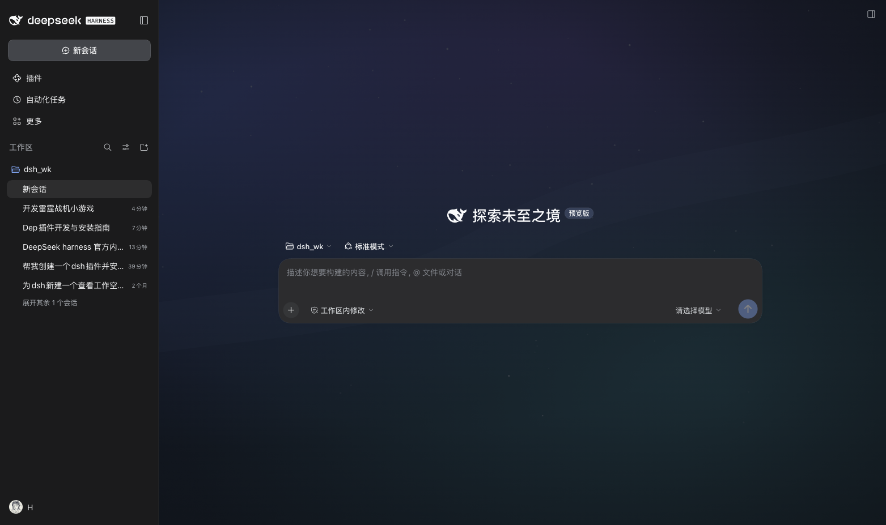

# hongxsen 的 DSH 插件

给 [DeepSeek Harness](https://github.com/deepseek-ai) 用的插件集合。每个插件一个子目录，统一通过本仓库的插件市场索引分发。

**插件市场索引源**

```
https://hongxsen.github.io/dsh_plugins/index.json
```

在 DSH 的「插件 → 发现 → 添加索引源」里填入上面这个地址，就能看到本仓库全部插件并一键安装。

## 插件列表

| 插件 | 说明 | 版本 | 目录 |
|---|---|---|---|
| **壁纸** `@hongxsen/dsh-wallpaper` | 在设置里切换 5 张内置壁纸，或用你自己的图片；界面变成磨砂玻璃让壁纸透出来，深浅色自动换画 | 0.2.0 | [plugins/wallpaper](plugins/wallpaper) |
| **人机双写** `@hongxsen/dsh-co-write` | 在对话或工作区文件里选中文字，就地评论；编号引用随下一条消息提交 | 0.1.0 | [plugins/co-write](plugins/co-write) |



## 手动安装某个插件

从索引里查到该版本的 commit（或直接用标签），带上 `path` 参数安装：

```sh
dsh plugin --profile desktop add \
  "git+https://github.com/hongxsen/dsh_plugins.git#wallpaper-v0.2.0&path:/plugins/wallpaper"
```

本地开发时直接指向目录：

```sh
dsh plugin --profile desktop add /绝对路径/dsh_plugins/plugins/wallpaper
```

卸载：

```sh
dsh plugin --profile desktop remove @hongxsen/dsh-wallpaper
```

## 仓库结构

```
README.md               本文件：插件总览与索引地址
LICENSE                 仓库级 MIT 许可
docs/
  index.json            插件市场索引（GitHub Pages 从这里发布）
  *.png                 README 与插件页用的截图
plugins/
  wallpaper/            壁纸插件（独立 npm 包，有自己的 package.json）
  co-write/             人机双写插件（独立 npm 包，有自己的 package.json）
```

约定：

- 每个插件是 `plugins/<名字>/` 下的**独立包**，自己带 `package.json`、`dsh.bundle.patch`、locale 与图标；
- 构建产物（如 `client.js`）必须提交——安装者不会执行构建；
- 新增插件时在 `docs/index.json` 的 `plugins` 数组里加一条，`source.path` 写 `plugins/<名字>`；
- 发版用「插件名 + 版本」的标签，例如 `wallpaper-v0.2.0`，索引里的 `source.commit` 固定到该版本的提交。

## 新增一个插件的完整流程

```sh
mkdir -p plugins/my-plugin
# 写入 package.json / cordis.patch.yml / index.js / client.js / locale / icon.svg
cd plugins/my-plugin && node build.mjs        # 如果有构建步骤
git add -A && git commit -m "feat(my-plugin): ..."
```

然后编辑 `docs/index.json`，追加插件与版本条目（`source.type: "git"`、`url` 指向本仓库、`commit` 填上面的提交、`path: "plugins/my-plugin"`），提交推送即可。

## License

MIT
