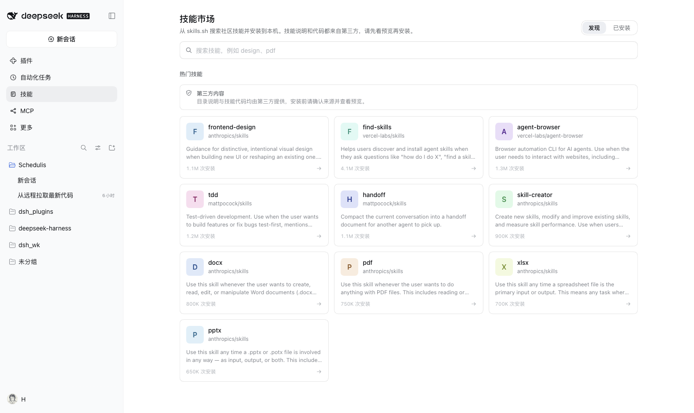
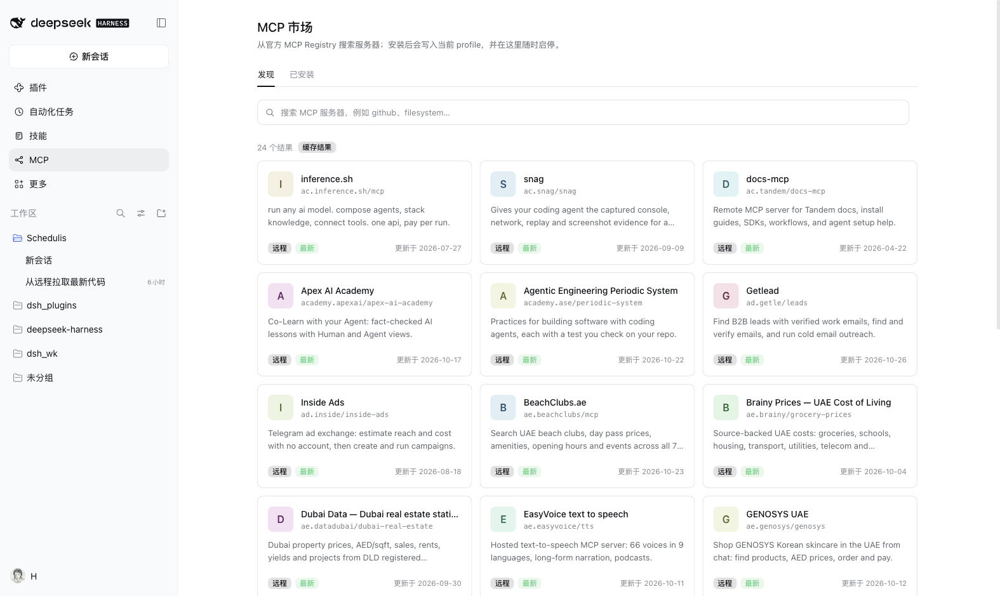

# hongxsen 的 DSH 插件

给 [DeepSeek Harness](https://github.com/deepseek-ai) 用的插件集合。每个插件一个子目录，统一通过本仓库的插件市场索引分发。

**插件市场索引源**

```
https://hongxsen.github.io/dsh_plugins/index.json
```

在 DSH 的「插件 → 发现 → 添加索引源」里填入上面这个地址，就能看到本仓库全部插件并一键安装。

## 插件列表

| 插件 | 说明 | 版本 | 目录 |
|---|---|---|---|
| **壁纸** `@hongxsen/dsh-wallpaper` | 在设置里切换 5 张内置壁纸，或用你自己的图片；界面变成磨砂玻璃让壁纸透出来，深浅色自动换画 | 0.2.0 | [plugins/wallpaper](plugins/wallpaper) |
| **技能市场** `@hongxsen/dsh-skills-market` | 从 skills.sh 或自定义 JSON/skills.sh 市场源搜索技能，也可从本机目录/集合目录安装；预览全部文件后安装到 `~/.dsh/skills`，并管理 `~/.dsh` 与 `~/.agents` 的已安装技能 | 0.3.2 | [plugins/skills-market](plugins/skills-market) |
| **MCP 市场** `@hongxsen/dsh-mcp-market` | 从官方 MCP Registry 或自定义 JSON/Registry 市场源搜索服务器，也可手动添加本地 stdio 服务器；按需填写密钥后写入当前配置，并管理启停 | 0.3.0 | [plugins/mcp-market](plugins/mcp-market) |
| **人机双写** `@hongxsen/dsh-co-write` | 在对话或工作区文件里选中文字，就地评论；编号引用随下一条消息提交 | 0.1.0 | [plugins/co-write](plugins/co-write) |
| **多平台 IM 机器人** `@hongxsen/dsh-im-bot` | 通过企业微信、QQ 官方机器人和飞书长连接与 DSH 交互；支持多连接、会话恢复、排队与进度反馈 | 0.1.0 | [plugins/im-bot](plugins/im-bot) |






## 技能市场与 MCP 市场

装好这两个插件后，侧边栏会多出「技能」和「MCP」两个入口：

- **技能**：搜索 [skills.sh](https://www.skills.sh) 的公开目录，打开条目查看 `SKILL.md`、全部文件和安全提示，确认后安装到 `~/.dsh/skills/<name>`。本地安装也支持 `~/.claude/skills` 这类集合目录，先选择具体技能再预览。DSH 的文件技能提供者会自动发现新技能，无需重启。已安装列表同时覆盖 `~/.dsh/skills` 和 `~/.agents/skills`；删除只处理市场自己安装的技能，手工或共享目录保持只读。
- **MCP**：搜索[官方 MCP Registry](https://registry.modelcontextprotocol.io)，选择托管地址或 `npx` / `uvx` / `docker` 包，填写必需的密钥，插件会把一条 `@deepseek-ai/dsh-mcp-client` 配置写进当前 profile 的 `cordis.patch.yml` 受管区块。有 HMR 时立即生效，没有 HMR 的部署会提示重启。手工配置的 MCP 行只读展示，不会被改写。

两个市场都支持在发现页左侧切换或添加自定义市场源（skills.sh 兼容 / JSON 索引；MCP Registry 兼容 / JSON 索引），市场源保存在 `~/.dsh/storages/dsh-*-market/sources.json`。JSON 索引还可以直接指向本机的 `file://`、绝对路径或 `~/` 路径。

两个市场也都支持本地安装：技能市场可以从本机目录或单个 `SKILL.md` 安装；MCP 市场可以手动填写本机可执行文件、参数、环境变量和工作目录，直接写入 stdio 托管行，不经过 shell。安装前都会展示内容并要求确认。MCP 的密钥会写进当前 profile 的 `cordis.patch.yml`（权限 `0600`），并在 `~/.dsh/storages/dsh-mcp-market/servers.json` 保留一份；如果不想把密钥落在配置里，可以在安装后把对应值改成 `!!js process.env.YOUR_ENV`。

## 手动安装某个插件

从索引里查到该版本的 commit（或直接用标签），带上 `path` 参数安装：

```sh
dsh plugin --profile desktop add \
  "git+https://github.com/hongxsen/dsh_plugins.git#wallpaper-v0.2.0&path:/plugins/wallpaper"

# 两个市场插件
dsh plugin --profile desktop add \
  "git+https://github.com/hongxsen/dsh_plugins.git#skills-market-v0.3.2&path:/plugins/skills-market"
dsh plugin --profile desktop add \
  "git+https://github.com/hongxsen/dsh_plugins.git#mcp-market-v0.3.0&path:/plugins/mcp-market"
```

本地开发时直接指向目录：

```sh
dsh plugin --profile desktop add /绝对路径/dsh_plugins/plugins/wallpaper
```

卸载：

```sh
dsh plugin --profile desktop remove @hongxsen/dsh-wallpaper
```

## 仓库结构

```
README.md               本文件：插件总览与索引地址
LICENSE                 仓库级 MIT 许可
docs/
  index.json            插件市场索引（GitHub Pages 从这里发布）
  *.png                 README 与插件页用的截图
plugins/
  wallpaper/            壁纸插件（独立 npm 包，有自己的 package.json）
  skills-market/        技能市场：skills.sh 搜索、预览与安装
  mcp-market/           MCP 市场：官方 Registry 搜索与服务器管理
  co-write/             人机双写插件（独立 npm 包，有自己的 package.json）
  im-bot/               多平台 IM 机器人：企微、QQ、飞书与多连接
```

约定：

- 每个插件是 `plugins/<名字>/` 下的**独立包**，自己带 `package.json`、`dsh.bundle.patch`、locale 与图标；
- 构建产物（如 `client.js`）必须提交——安装者不会执行构建；
- 新增插件时在 `docs/index.json` 的 `plugins` 数组里加一条，`source.path` 写 `plugins/<名字>`；
- 发版用「插件名 + 版本」的标签，例如 `wallpaper-v0.2.0`，索引里的 `source.commit` 固定到该版本的提交。

## 新增一个插件的完整流程

```sh
mkdir -p plugins/my-plugin
# 写入 package.json / cordis.patch.yml / index.js / client.js / locale / icon.svg
cd plugins/my-plugin && node build.mjs        # 如果有构建步骤
git add -A && git commit -m "feat(my-plugin): ..."
```

然后编辑 `docs/index.json`，追加插件与版本条目（`source.type: "git"`、`url` 指向本仓库、`commit` 填上面的提交、`path: "plugins/my-plugin"`），提交推送即可。

## License

MIT
