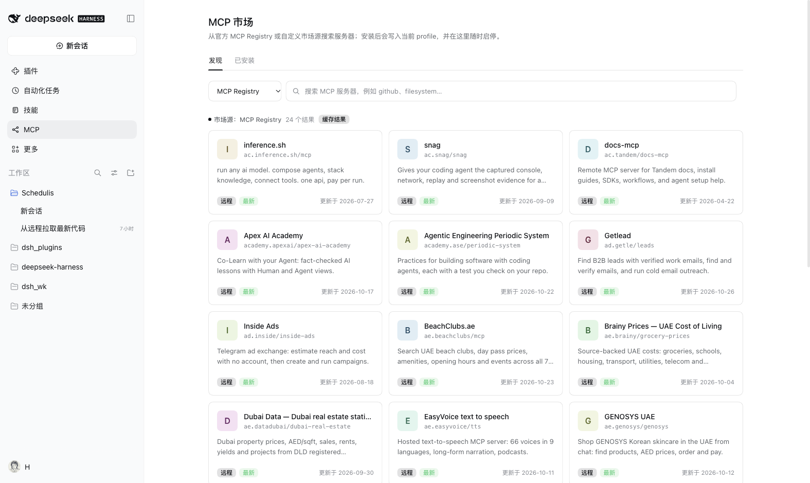
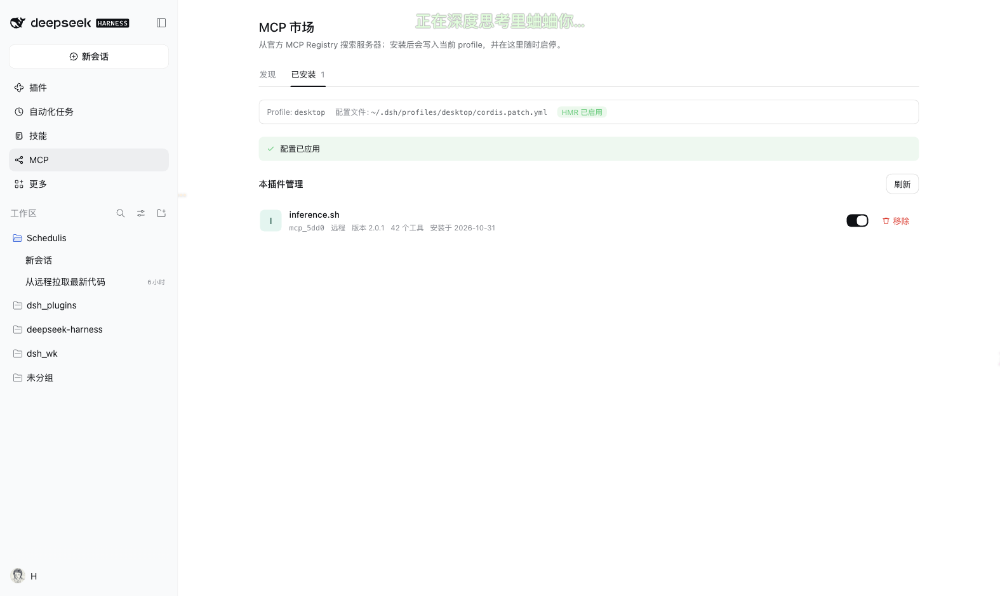

# DSH MCP Market · MCP 市场

给 [DeepSeek Harness](https://github.com/deepseek-ai) Web UI 的 MCP 市场插件：在侧边栏里搜索官方
[MCP Registry](https://registry.modelcontextprotocol.io)，打开条目，选择连接方式并填写凭据，一键写成
`@deepseek-ai/dsh-mcp-client` 的托管配置；之后可以在这里启停、替换或移除。





> 本仓库是插件集合，这个插件位于 `plugins/mcp-market/`。根目录 [README](../../README.md) 有索引源地址和完整插件列表。

## 功能

- **官方 Registry**：直接请求 `https://registry.modelcontextprotocol.io/v0/servers`，按关键词搜索、查看详情；结果缓存 5 分钟，离线、限流、超时都会给出可重试的错误。
- **两种连接方式**：`streamable-http` 远程服务，或 npm / PyPI / OCI 的 stdio 本地进程（分别用 `npx` / `uvx` / `docker` 启动）。
- **安装前预检**：生成 `@deepseek-ai/dsh-mcp-client` 配置，收集必填请求头和环境变量，检查运行命令是否存在；预览里的敏感值始终打码。
- **托管块写入**：只改当前 profile 的 `cordis.patch.yml` 中带标记的托管块；块外的行、注释、空行和结尾保持原样。首次修改前留一份一次性备份。
- **启停与移除**：关闭的行从托管块中省略，但记录保留；移除只删除本插件管理的行。
- **外部行只读**：patch 里原本就有的 `@deepseek-ai/dsh-mcp-client` 行会被识别并展示，但本插件不修改。
- **工具计数**：已安装行会从 `ctx.get('tools')?.schemas?.()` 里统计 `mcp__<serverName>__` 前缀的工具数。
- **HMR 感知**：检测到 `ctx.get('hmr')` 时返回「已应用」，否则明确提示需要重启 DSH。
- **中英双语**、键盘可操作、搜索防抖 300 ms、加载 / 空 / 错误状态、成功 Toast。

## 安装

**推荐：从插件市场安装**

在「插件 → 发现 → 添加索引源」填入 `https://hongxsen.github.io/dsh_plugins/index.json`，然后点「MCP 市场」卡片上的**安装**。

**命令行（固定到 commit，`path` 指向子目录）**

```sh
dsh plugin --profile desktop add \
  "git+https://github.com/hongxsen/dsh_plugins.git#<commit>&path:/plugins/mcp-market"
```

`<commit>` 用索引文件里该版本记录的 40 位哈希，或者一个标签。

**本地目录**（自己改代码时）

```sh
dsh plugin --profile desktop add /绝对路径/dsh_plugins/plugins/mcp-market
```

安装后如未立即出现，重启一次 DSH。卸载：

```sh
dsh plugin --profile desktop remove @hongxsen/dsh-mcp-market
```

本包**没有任何安装脚本**。

## 自定义市场 / Custom markets

「发现」页搜索框左侧有一个市场源下拉框，最后一项「管理市场源…」可以添加、切换和移除市场源。选择会写入宿主端，刷新页面或重启后保留。

支持两类市场源：

- **MCP Registry 兼容**：一个实现 `GET /v0/servers?search=&limit=&version=latest` 的服务地址。适合自建镜像。
- **JSON 索引**：一个静态 JSON 文档，列出服务器条目。示例：

```json
{
  "format": 1,
  "title": "Team MCP",
  "servers": [
    {
      "name": "com.acme/weather",
      "title": "Acme Weather",
      "description": "Weather tools for internal services.",
      "version": "1.0.0",
      "remotes": [
        { "type": "streamable-http", "url": "https://mcp.acme.test/mcp" }
      ],
      "packages": []
    }
  ]
}
```

条目也可以直接使用官方 Registry 的 `{ "server": { ... } }` 包装。安装/预览时会从当前市场源重新读取条目，不信任浏览器提交的 URL 或命令；`@deepseek-ai/dsh-mcp-client` 的配置仍按原有规则校验后写入受管区块，并记录来源名称。

市场源保存在 `<DSH_HOME>/storages/dsh-mcp-market/sources.json`（权限 `0600`，内置源不可删除）。索引文档限制 2 MiB / 2000 条，缓存 5 分钟；地址只允许 `http(s)`，不能带用户名密码或 `#fragment`。SSE-only 条目仍会显示为“不支持”。

## 写入位置

安装或启停时只写三处：

| 路径 | 用途 |
|---|---|
| 当前 profile 的 `cordis.patch.yml` | 写入/重写两个标记之间的托管块 |
| `<该 patch>.dsh-mcp-market.bak` | 第一次修改前的一次性备份 |
| `~/.dsh/storages/dsh-mcp-market/servers.json` | 本插件管理的服务器记录（0600） |

托管块长这样，块内只包含 `enabled: true` 的行：

```yaml
# >>> dsh-mcp-market managed block — do not edit between the markers
- insert:
    - id: mcp-market-weather_ab12
      name: '@deepseek-ai/dsh-mcp-client'
      config:
        serverName: weather_ab12
        transport: streamable-http
        url: 'https://example.com/mcp'
        headers:
          Authorization: 'Bearer ...'
# <<< dsh-mcp-market managed block
```

- 本地进程用 `transport: stdio`、`command: npx|uvx|docker`、`args` 与可选的 `env`。
- `serverName` 由 registry name 的末段 + 4 位稳定哈希组成（≤32 字符），重复安装同一服务器会复用同一个 `rowId`。
- 写入是「临时文件 + rename」且串行化的；两个操作不会交错。
- 备份只创建一次，不会覆盖你后来手动保存的版本。

## 安全说明

- **第三方内容**：目录里的标题、描述、链接、包名、命令和请求头声明都来自第三方注册表。安装前请自行确认来源；安装后 MCP 服务器会以你的身份访问网络和本地资源。
- **凭据是明文**：请求头和 `env` 值会明文写入 profile 的 `cordis.patch.yml`（0600）和 `servers.json`（0600）。不要在不信任的机器或共享 profile 里安装带密钥的服务器。
- **不信任浏览器输入**：安装时 Host 端会按 registry name 重新拉取条目，客户端提交的 URL、命令、包名一律不采用；只允许 `http:`/`https:` URL 和固定的 `npx`/`uvx`/`docker` 命令，不经过 shell。
- **输入校验**：每个请求头/环境变量值必须是字符串且 ≤ 8 KiB；请求头不能含换行；未知/危险键、非法环境变量名会被拒绝。
- **路由边界**：API 只挂在 `/dsh-mcp-market` 前缀下，同源校验（Origin 与 Host 不一致返回 403）、POST 只接受 `application/json`、请求体上限 1 MiB、响应 `Cache-Control: no-store`。
- **自定义源是显式信任边界**：市场源由用户手动添加，Host 会直接请求该地址（允许 `http(s)`，上限 2 MiB / 10 秒）。不要添加不受信任的内网地址；安装时仍会从该源重新读取条目并做配置校验。
- **移除行为**：只删除 `servers.json` 里登记的行并重写托管块；托管块之外的行、其他插件、服务器自己的数据都不会被改动。

## HMR 与重启

每次安装、启停、移除后：

```js
const hmr = ctx.get('hmr')
return { applied: hmr !== undefined, restartRequired: hmr === undefined }
```

- 有 HMR：文件写入后由 DSH 的 profile 监听器在几秒内自动重组，页面提示「配置已应用」。
- 没有 HMR：页面明确提示「配置已写入，重启 DSH 后生效」。
- 插件不调用任何内部 recompose API，也不直接改 Loader 树。

## 兼容性

`package.json` 声明 `"engines": { "dsh": ">=0.2.1-0 <0.3.0" }`，不满足时安装会在下载前被拒绝。真要在更新的预发布版本上试，用 DSH 给出的豁免命令：

```sh
dsh plugin --profile desktop allow-version @hongxsen/dsh-mcp-market@0.1.0 --dsh-version <运行时版本> --accept-risk
```

## 目录结构

```
package.json          清单：bundle patch + dsh.client（platform: web）
cordis.patch.yml      往 profile 组合树插一行
index.js              Host 入口：注册 /dsh-mcp-market 前缀路由
lib/http.js           请求校验、路由分发、JSON 错误信封
lib/service.js        DSH 上下文绑定：profile、HMR、tools、运行时探测
lib/registry.js       Registry 搜索/详情、规范化、5 分钟缓存
lib/config.js         纯逻辑：args/env/header 构建、校验、打码、预览
lib/yaml.js           托管块渲染/替换/移除、外部行解析
lib/patch.js          原子写入、一次性备份、串行队列
lib/store.js          servers.json（0600）
lib/slug.js           serverName / rowId
lib/errors.js         ApiError 与 mcp/* 错误码
src/model.mjs         浏览器纯逻辑：防抖、校验、请求封装、单字母头像
src/ui.js             React 面板（无 JSX）：发现 / 详情 / 已安装
src/entry.js          Client 插件入口（inject + apply）
build.mjs             把 model/ui/entry 与 locale 内联成 client.js
client.js             构建产物（浏览器实际加载，必须提交）
locale/{en,zh}.json   完整界面词典 + 插件页标题/描述
icon.svg              插件页图标
tests/*.test.mjs      纯逻辑、patch、路由、服务与 bundle 测试
```

## 开发

```sh
cd plugins/mcp-market
node build.mjs                 # 重新生成 client.js
node --test tests/*.test.mjs   # 运行全部测试
```

- `client.js` 是生成文件，必须随源码一起提交；安装者不会执行构建。
- Host 侧没有 npm 依赖，只使用 Node 内置模块。
- 浏览器侧没有外部依赖，`require('react')` 由 DSH 客户端提供。
- 测试不会访问真实网络或 `~/.dsh`：registry 使用注入的 fetch，patch/store 使用临时目录。

## 已知限制

- **SSE 暂不支持**：只保留 `streamable-http` 远程；只有 SSE 的条目会显示「暂不支持」。
- **必填包参数 / URL 变量**：如果条目声明了必填的 `packageArguments` 或 URL 变量且注册表没有默认值，安装表单没有对应输入框，会以 `mcp/needs-input` 阻止安装。
- **仅三种包注册表**：npm / PyPI / OCI，且只处理 `stdio` transport。为生成可运行的命令，`npx` 默认补 `-y`，Docker 默认补 `run -i --rm`（已有同名参数时不重复）。
- **首页只取一页**：搜索接口取 24 条，响应保持 `{ query, servers, cached }`；当前 UI 不做「加载更多」。
- **精确名详情接口**：优先尝试 `GET /v0/servers/<name>`；该端点 404 时回退到精确名搜索，再回退到 `version=latest` 搜索（都缓存 5 分钟）。
- **图标**：不加载远程图标，统一使用确定性单字头像；这样没有额外网络请求和 SVG 执行风险。
- **凭据明文**：这是 profile patch 的固有限制，插件只保证文件 0600 与界面打码，不提供加密存储。
