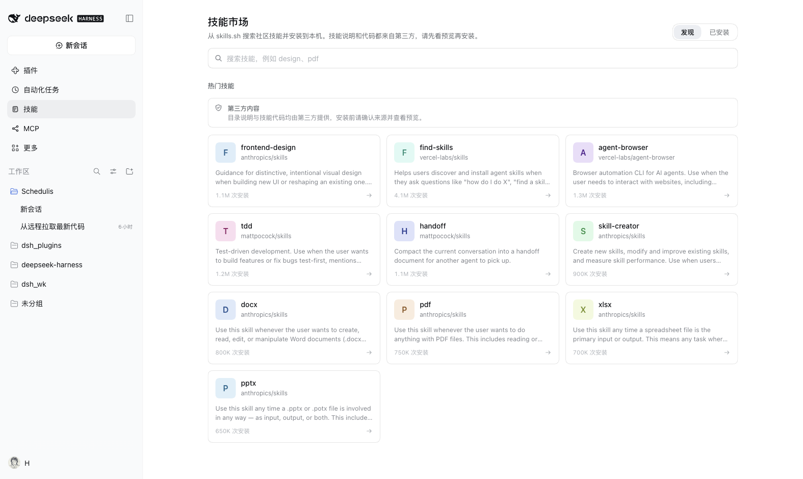
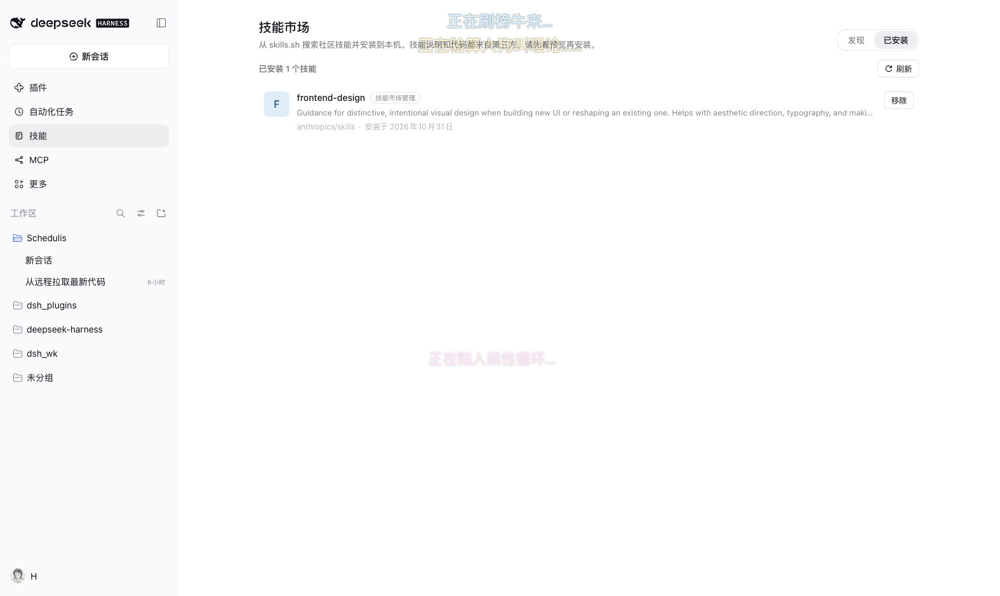

# 技能市场 · Skills Market

`@hongxsen/dsh-skills-market` 是 DSH Web 界面里的整页插件：从 [skills.sh](https://www.skills.sh) 搜索社区 Agent Skill，先预览仓库文件、安全提示与安装位置，再写入本机 `~/.dsh/skills`，并在同一个面板里管理已安装技能。

- 侧边栏入口：**技能 / Skills**（order `20`），与主区域页面共用 `skills-market` 这个 id。
- 两个视图：**发现**（搜索、热门 seed、详情、安装预览）和 **已安装**（来源、安装时间、安全提示计数、移除）。
- 全部界面文案有中文和英文两份字典；没有外部 npm 依赖，也没有远程图片。

## 截图





## 安装

从插件市场安装（`docs/index.json` 发布后）：

```sh
dsh plugin --profile desktop add \
  "git+https://github.com/hongxsen/dsh_plugins.git#<commit>&path:/plugins/skills-market"
```

本地开发时直接指向目录：

```sh
dsh plugin --profile desktop add /绝对路径/dsh_plugins/plugins/skills-market
```

卸载：

```sh
dsh plugin --profile desktop remove @hongxsen/dsh-skills-market
```

要求：DSH `>=0.2.1-0 <0.3.0`、Node 24、Web 界面（插件声明了 `platform: web`）。

## 自定义市场 / Custom markets

「发现」页搜索框左侧有一个市场源下拉框，最后一项「管理市场源…」可以添加、切换和移除市场源。选择会写入宿主端，刷新页面或重启后保留。

支持两类市场源：

- **skills.sh 兼容**：一个提供 `GET /api/search?q=` 和 `/<owner>/<repo>/<skill>` 详情页的服务地址。适合自建镜像或代理。
- **JSON 索引**：一个静态 JSON 文档，适合团队私有技能目录。示例：

```json
{
  "format": 1,
  "title": "Team Skills",
  "skills": [
    {
      "name": "deploy-helper",
      "source": "acme/skills",
      "skillId": "deploy-helper",
      "description": "Deploy the internal service.",
      "installs": 42,
      "tags": ["ops", "deploy"],
      "homepage": "https://github.com/acme/skills"
    }
  ]
}
```

`source` 必须是 GitHub 的 `owner/repo`，`skillId` 用于定位技能目录；安装时仍然从 GitHub 下载、解析 `SKILL.md`、做安全扫描并展示预览。也就是说，自定义索引只改变“发现”的来源，不绕过安装校验。

市场源保存在 `<DSH_HOME>/storages/dsh-skills-market/sources.json`（权限 `0600`，内置源不可删除）。索引文档限制 2 MiB / 2000 条，缓存 5 分钟；HTTP 地址只允许 `http(s)`，不能带用户名密码或 `#fragment`；JSON 索引类型还允许 `file://`、绝对路径或 `~/` 路径，方便直接读取本机目录里的索引。自定义源的内容同样来自第三方，安装前请查看预览与安全提示。

## 本地安装 / Local install

「发现」页搜索框右侧的「本地安装」按钮可以从本机目录安装技能：

- 填一个包含 `SKILL.md` 的目录，或直接填一个 `SKILL.md` 文件；
- 支持绝对路径、`~/` 和 `file://`；相对路径会被拒绝；
- 预览阶段会校验 frontmatter、列出全部文件并执行与远程安装相同的安全扫描，确认后才写入 `~/.dsh/skills/<name>`；
- 原目录只读，不会被移动、复制后再删除或修改；符号链接、特殊文件和 `..` 路径会被拒绝；
- 目录最多 200 个文件 / 8 MiB，单文件 4 MiB；`SKILL.md` 文件会规范化为 `<name>/SKILL.md`。

本地安装同样使用 Host 侧的 staging token 和预览确认，浏览器不能直接指定目标目录或绕过扫描。

## 技能装到哪里

- 技能目录：`<DSH_HOME>/skills/<frontmatter-name>/`，默认即 `~/.dsh/skills/<name>/`；如果 `skills` 本身是符号链接，安装会被拒绝（`skills/install-failed`）。
  - `DSH_HOME` 的解析顺序与 DSH 一致：显式配置 → `$DSH_HOME` → `~/.dsh`。
  - 安装时以 `SKILL.md` frontmatter 里的 `name`（kebab-case）作为目录名。
  - 扁平技能（仓库里的 `<skillId>.md`）会规范化成 `<name>/SKILL.md`，保证结果是一个标准技能目录。
- 预览暂存：`<DSH_HOME>/storages/dsh-skills-market/staging/<uuid>/`，保留最新 5 份、15 分钟过期；安装成功后立即删除。
- 安装记录：`<DSH_HOME>/storages/dsh-skills-market/installed.json`（`{ version: 1, skills: { <name>: {...} } }`，原子写入、权限 `0600`）。
- 替换/移除时的旧目录：`<DSH_HOME>/skills/.trash/<name>-<timestamp>`，成功后才删除；失败会回滚。安装与移除前都会用 `lstat` + `realpath` 检查 `.trash`，符号链接会被拒绝。

插件只写这两个根：`skills/` 与 `storages/dsh-skills-market/`。离开 `~/.dsh/skills` 的目录永远不会被删除。

## 安全说明

- **第三方内容**：技能描述、文件和代码都来自第三方仓库。发现页与预览弹窗都有提示；客户端只渲染纯文本，不渲染 HTML。
- **安装预览**：Host 先解析 GitHub tree，按 `SKILL.md` 匹配目录，最多 200 个文件 / 8 MiB，单文件 4 MiB；拒绝 `..`、绝对路径、符号链接与目录外条目。预览返回文件列表、总大小、`SKILL.md` 摘要和路径；安全提示最多返回 200 条，`warningTotal` 给出真实总数。
- **安全扫描**：对 ≤256 KiB 的文本文件检查 `curl … | sh`、`wget … | sh`、`eval(`、`new Function(`、`child_process`、`rm -rf /`、`sudo `、`process.env` + 网络、base64 解码后执行、`~/.ssh`、`~/.aws`。命中只产生警告，不阻断安装，但安装按钮需要**第二次点击**确认；预览弹窗逐条展示 `file:line` 与最多 160 字符的片段。
- **前端校验不替代 Host 校验**：安装接口只接收 staging token，Host 会重新校验暂存文件、frontmatter 与目标路径；不会信任浏览器传来的文件名或目录。
- **替换与移除**：`replace` 只允许覆盖 `installed.json` 里记录过、且位于技能根目录内的目录；符号链接、目录外路径、未知目录一律拒绝（`skills/not-managed`）。移除只针对本插件安装并记录过的技能，先移到 `.trash` 再删除，然后清理记录。
- **不记录敏感信息**：本插件不读取、不记录 `GITHUB_TOKEN`、请求头、环境变量或页面内容；`GITHUB_TOKEN`（如果 Host 环境里有）只用于 GitHub API 请求，出现在错误信息里的只会是 HTTP 状态码。
- **自定义源是显式信任边界**：市场源由用户手动添加，Host 会直接请求该地址（HTTP 源允许 `http(s)`，本机索引允许 `file://`/绝对路径/`~/`，上限 2 MiB / 10 秒）。不要添加不受信任的内网地址；索引内容仍要经过安装预览与安全扫描。
- **本地安装只读源目录**：从本机安装时 Host 用 `realpath` + `lstat` 校验路径，拒绝符号链接、特殊文件、`..` 和超出上限的目录；只读取源目录并写入 staging 与技能根，不会改源目录。
- **网络降级**：目录搜索超时/离线/限流时回退到内置热门列表；详情描述抓取失败只返回空描述，不阻塞详情页。

## HMR 与重启

插件本身没有 Host 配置需要热更新：Host 只注册前缀路由，浏览器 bundle 由 DSH 客户端加载器加载。

- 只改 `client.js` 且 profile 启用了 HMR：客户端会重新加载 bundle，无需重启 DSH。
- 改 `index.js` / `lib/*`、或 profile 没有 HMR：需要重启 DSH 让 Host 路由与依赖图重新装配。
- 安装/移除技能是文件系统操作，DSH 的技能提供方按自己的 watcher 策略发现变化；本插件不调用任何内部 recompose API。

## HTTP API

前缀路由：`/dsh-skills-market`。所有响应 `Cache-Control: no-store`，错误统一为 `{ error: { code, message, details? } }`，不返回堆栈。POST 仅接受 `application/json`（否则 415），请求体上限 1 MiB（否则 413），跨站 `Origin` 与 `Host` 不一致时 403。

| 方法 | 路径 | 请求 | 响应 |
|---|---|---|---|
| GET | `/api/search?q=&source=` | — | `{ seed, query, skills, cached, warning?, source }` |
| GET | `/api/detail?market=&repo=&skill=` | — | `{ description, pageUrl, title }`（`source` 仍作为 `repo` 的旧别名） |
| GET | `/api/sources` | — | `{ version, selected, sources }` |
| POST | `/api/sources` | `{ action: "add"\|"remove"\|"select", ... }` | `{ selected, sources, source? }` |
| POST | `/api/preview` | `{ source, skillId }` | `{ token, name, description, source, skillId, repo, branch, path, files, totalBytes, skillMd, warnings, warningTotal, existing, target }` |
| POST | `/api/local/preview` | `{ path }` | 同 `/api/preview`，另带 `kind: "local"`、`localPath`，`repo`/`branch` 为空 |
| POST | `/api/install` | `{ token, replace? }` | `{ installed: true, name }` |
| GET | `/api/installed` | — | `{ skills: [...] }` |
| POST | `/api/remove` | `{ name }` | `{ removed: true }` |
| GET | `/api/health` | — | `{ ok: true, root, version, sources }` |

错误码：`skills/invalid-query`、`skills/fetch-failed`、`skills/not-found`、`skills/invalid-skill`、`skills/too-large`、`skills/exists`、`skills/not-managed`、`skills/staging-expired`、`skills/install-failed`、`skills/invalid-path`、`sources/invalid`、`sources/limit`、`sources/not-found`、`sources/builtin`、`sources/fetch-failed`、`sources/invalid-index`；请求层另有 `request/forbidden-origin`、`request/unsupported-media-type`、`request/body-too-large`、`request/invalid-json`、`request/not-found`、`request/method-not-allowed`、`internal/error`。

## 开发

```sh
cd plugins/skills-market

# 重新生成提交用的 client.js（构建会顺带校验中英文字典的 key 是否一致）
node build.mjs

# 纯 Host 助手、暂存/安装、路由、客户端 bundle 的单元测试
node --test tests/*.test.mjs
```

目录结构：

```
index.js              Host 入口：name / inject / apply，注册前缀路由
lib/
  constants.js        限额、seed、缓存 TTL、版本
  errors.js           稳定错误码与 HTTP 映射
  paths.js            DSH home、技能/staging/trash 路径、路径穿越防护
  frontmatter.js      SKILL.md frontmatter 解析与 kebab 校验
  tree.js             GitHub tree 技能匹配、文件收集与上限
  scan.js             安全扫描规则
  remote.js           有界 fetch、skills.sh 搜索/详情、GitHub API/raw
  metadata.js         installed.json 原子读写
  installed.js        已安装技能扫描与警告统计
  local.js            本机目录/SKILL.md 预览、文件上限与路径校验
  staging.js          预览、原子安装/回滚、受控移除
  skills.js           Market service（缓存、预览流水线、安装/移除编排）
  routes.js           前缀路由、请求校验、JSON 响应
src/
  model.mjs           纯浏览器助手 + API client
  ui.js               React 组件与 CSS（无 JSX）
  entry.js            inject / apply，注册侧边栏与 main slot
build.mjs             拼接 src + locale/*.json → client.js
locale/{zh,en}.json   市场页标题/描述（meta）+ 字典（构建时内联）
icon.svg               64×64 图标
```

已知限制：

- 目录搜索与详情依赖 `https://www.skills.sh` 的公开接口；它不可用时只能看到内置热门列表，安装仍可用（预览走 GitHub）。
- GitHub 未认证 API 有速率限制；设置 Host 环境的 `GITHUB_TOKEN` 可提高配额。`truncated` 的 tree 仍会尝试已返回的路径，但极端巨型仓库可能找不到技能（返回 `skills/not-found`）。
- 未在 Windows 上验证；路径处理使用 `node:path` 并在安装时做 realpath 检查。
- 已安装技能的安全警告计数是每次打开「已安装」时重新扫描得到的（单文件 ≤256 KiB），不是后台常驻扫描。
