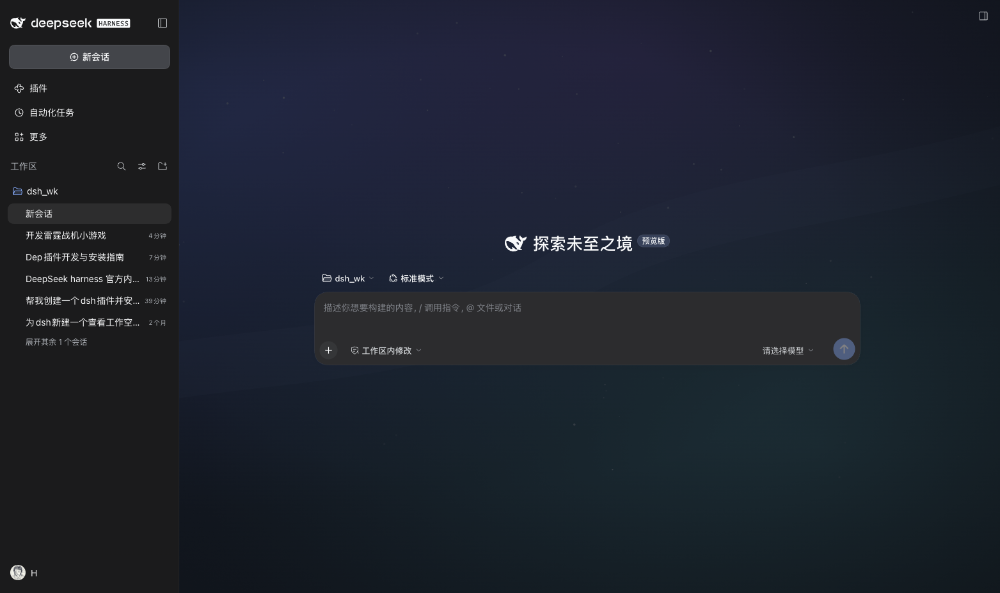
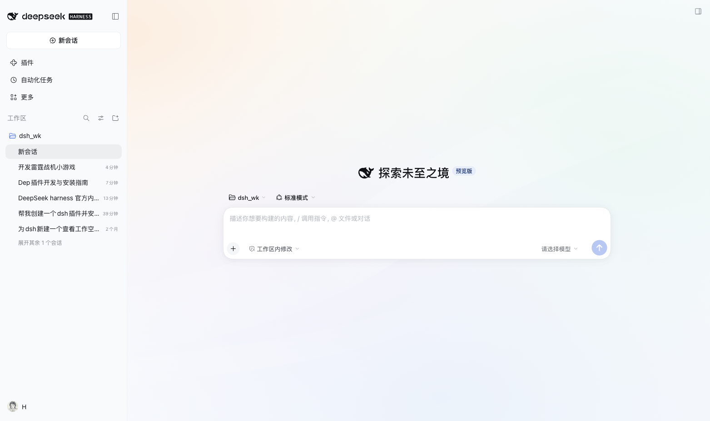
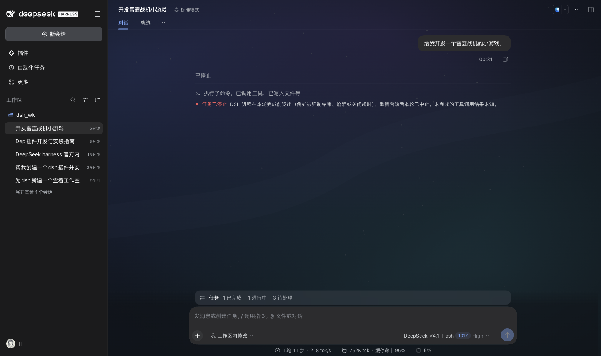
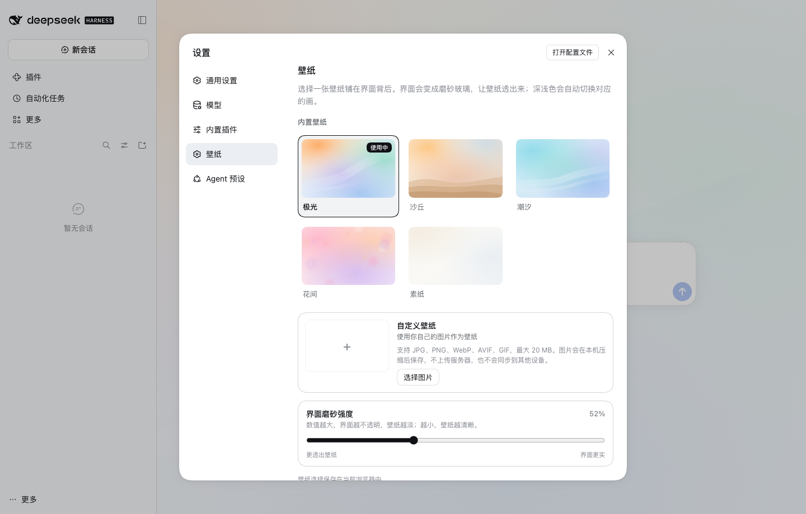

# DSH Wallpaper · 壁纸

给 [DeepSeek Harness](https://github.com/deepseek-ai) 的 Web UI 铺一张原创壁纸，并把界面刷成磨砂玻璃让壁纸透出来。内置 5 张深浅色各一套的画，在「设置 → 壁纸」里随时切换；也可以选一张自己的图片作为壁纸。





真实会话页（正文仍然清晰，壁纸只作为背景层）：



设置里的壁纸页（内置壁纸、自定义图片与磨砂强度）：



> 本仓库是插件集合，这个插件位于 `plugins/wallpaper/`。仓库根目录的 [README](../../README.md) 有索引源地址和完整插件列表。

## 功能

- **内置壁纸**：极光、沙丘、潮汐、花间、素纸，共 5 张；每张都有深色与浅色两个版本，跟随 DSH 的配色方案自动切换。
- **自定义图片**：在设置里选择 JPG / PNG / WebP / AVIF / GIF（最大 20 MB），也可以直接把图片拖进设置卡片。
- **本地压缩**：图片在本机缩放到最长边 2560 px 并重新编码，控制存储体积；不上传服务器，也不依赖网络。
- **磨砂强度**：可以调界面表面的不透明度（30%–92%），在「壁纸清楚」与「正文更实」之间取平衡。
- **随深色/浅色自动换画**：内置壁纸各有两套；自定义图片在两种配色下共用同一张图。
- **不联网、无安装脚本**：壁纸和样式都在 `client.js` 里；自定义图片只写入当前浏览器的 localStorage。

## 安装

**推荐：从插件市场安装**

在「插件 → 发现 → 添加索引源」填入 `https://hongxsen.github.io/dsh_plugins/index.json`，然后点「壁纸」卡片上的**安装**。

**命令行（固定到 commit，`path` 指向子目录）**

```sh
dsh plugin --profile desktop add \
  "git+https://github.com/hongxsen/dsh_plugins.git#<commit>&path:/plugins/wallpaper"
```

`<commit>` 用索引文件里该版本记录的 40 位哈希，或者一个标签，例如
`#wallpaper-v0.2.0`。

**本地目录**（自己改代码时）

```sh
dsh plugin --profile desktop add /绝对路径/dsh_plugins/plugins/wallpaper
```

安装后如未立即出现，重启一次 DSH。卸载：

```sh
dsh plugin --profile desktop remove @hongxsen/dsh-wallpaper
```

本包**没有任何安装脚本**，pnpm 不会要求你授权 build script。

## 使用

1. 打开「设置」。
2. 在左侧选择「壁纸」。
3. 点任意一张内置壁纸即可切换；「自定义壁纸」里点「选择图片」或拖入图片，会自动使用并保存。
4. 想换回默认，选择「极光」；想删掉自定义图片，点「移除」。

选择自定义图片后，可以：

- 点「使用这张壁纸」在自定义图片和内置壁纸之间来回切换；
- 点「更换图片」重新选择；
- 点「移除」并确认，删除当前浏览器里保存的图片。

> 壁纸选择与自定义图片保存在**当前浏览器**的 localStorage 中，不会写进 DSH 的 Host 设置，也不会同步到其他设备或浏览器。清理站点数据会一并清掉自定义图片。

## 兼容性

`package.json` 声明 `"engines": { "dsh": ">=0.2.1-0 <0.3.0" }`，不满足时安装会在下载前被拒绝。真要在更新的预发布版本上试，用 DSH 给出的豁免命令：

```sh
dsh plugin --profile desktop allow-version @hongxsen/dsh-wallpaper@0.2.0 --dsh-version <运行时版本> --accept-risk
```

## 自定义

| 想改什么 | 改哪里 |
|---|---|
| 内置壁纸的颜色/构图 | `build.mjs` 里的 `auroraLight` / `auroraDark` / `dune*` / `tide*` / `bloom*` / `paper*` |
| 增加一张内置壁纸 | 在 `build.mjs` 的 `WALLPAPERS` 里加一条，并同步 `src/model.mjs` 的 `BUILTIN_IDS`（构建会检查两边一致）；再在 `src/ui.js` 的 `SETTINGS_LOCALES` 里补 `builtin.<id>` 文案 |
| 磨砂强度范围/默认值 | `src/model.mjs` 的 `VEIL_MIN`、`VEIL_MAX`、`DEFAULT_VEIL` |
| 自定义图片尺寸/压缩质量 | `src/image.mjs` 的 `ENCODE_STEPS`，以及 `MAX_CUSTOM_DATA_URL` / `MAX_CUSTOM_INPUT_BYTES` |
| 设置页文案/顺序 | `src/ui.js` 的 `SETTINGS_LOCALES`，`src/entry.js` 里注册时的 `order` |
| 插件页显示的文字 | `locale/zh.json`、`locale/en.json` 的 `meta` |

改完运行：

```sh
node build.mjs
```

它会重新生成 `art/*.svg` 并把所有内置壁纸内联进 `client.js`。刷新页面即可看到效果（本地目录安装时不用重装）。

```sh
node --test tests/*.test.mjs   # 状态模型、校验与构建产物检查
```

> `client.js` 是构建产物，但必须提交进仓库——安装者不会执行构建。

## 实现原理

系统壳把页面背景画在 `body` 上，再用 `--dsw-alias-bg-base` 在主画布上重画一层，所以只给 `body` 加背景图是看不见的。这个插件：

1. 在 `body` 上铺当前壁纸（`cover` + `fixed`）；浅色与深色各用一个 CSS 变量，`body[data-ds-dark-theme]` 自动换画；
2. 把 `--dsw-alias-bg-base` 改成半透明 tint——所有「重画背景」的容器因此自动变成磨砂玻璃。不依赖哈希类名，UI 改版不会失效；
3. 菜单、Tooltip、Toast 继续用它们自己的 `--dsw-specific-*` token，保持不透明；
4. 尊重 `prefers-reduced-transparency`，并允许用滑块调磨砂强度；
5. 通过 `settings.section` 在设置导航里注册「壁纸」页；停用插件时样式、body 变量和设置页一起移除。

自定义图片在浏览器里用 canvas 缩放、编码成 WebP data URL，再与选择一起写入 `localStorage`。`src/model.mjs` 会严格校验读回的 data URL，避免被篡改的本地数据注入 CSS。

## 目录结构

```
package.json          清单：bundle patch + dsh.client（platform: web）
cordis.patch.yml      往 profile 组合树插一行
index.js              Host 侧空实现（有这一行才能在插件页启停）
src/model.mjs         纯状态模型：默认值、校验、选择与磨砂强度
src/image.mjs         自定义图片解码、缩放与压缩
src/ui.js             设置 → 壁纸页（React 组件、样式、文案）
src/entry.js          应用壁纸、持久化、注册设置页
client.js             构建产物（浏览器实际加载，必须提交）
build.mjs             生成 art/*.svg 并把 src 与壁纸内联进 client.js
tests/model.test.mjs  状态模型与构建产物测试
art/<id>-{light,dark}.svg  五张内置壁纸的深浅色原图
locale/{en,zh}.json   插件页标题与描述
icon.svg              插件页图标
```

截图与市场索引在仓库根目录的 `docs/` 下。

## 发布到 npm（可选）

```sh
cd plugins/wallpaper
npm publish --access public
```

之后别人可以直接在「添加插件」里填包名 `@hongxsen/dsh-wallpaper`，市场索引里的安装目标也简化成 `name@version`。

## License

MIT
